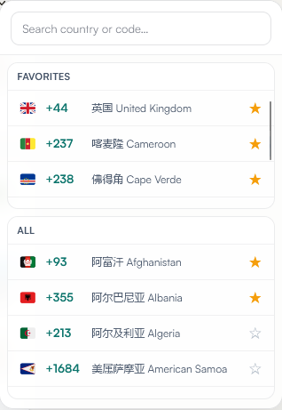
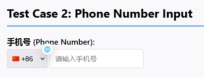

<div align="center">
<h1 align="center">Find-Your-Country-Code</h1>

[**English**](./README_EN.md) | **简体中文**

<p align="center">

**一个浏览器 js 脚本：识别网页里的手机号国家区号字段，挂 🌐 图标，点开即是可搜索的区号面板。可用于篡改猴。**
</p>
</div>

## 功能特性

- 多信号加权评分自动识别国家/区号字段（`select`、`input`、`intl-tel-input` 场景），按置信度分级行动：称呼前缀、固话本地区号、纯数字枚举等易混淆字段不再误报
- 高置信字段自动注入 🌐 图标；中置信低调注入（半透明小图标，悬停恢复）；低置信默认不注入，可从面板手动召唤
- 支持 `autocomplete` 标准信号（如 `tel-country-code`）与下拉选项内容验证
- 点击 🌐 图标打开区号面板，支持中文/英文国家名、ISO、区号搜索
- 收藏常用区号，GM 持久化保存
- 兼容动态页面：MutationObserver 自动扫描 + SPA 路由切换重扫，穿透 open Shadow DOM
- intl-tel-input v16–v29 版本适配；React/Vue 等受控组件经原生事件序列真实同步

## 截图预览

<table>
  <tr>
    <td style="vertical-align: top;">
      
    </td>
    <td style="vertical-align: top;">
      
    </td>
  </tr>
</table>

已知局限：closed Shadow Root 检测不到；跨帧面板消息在嵌套 shadow 宿主帧场景走降级提示（[src/main.ts](./src/main.ts)）。

## 使用

### 前置要求

安装以下任意一个浏览器扩展：

- [Tampermonkey](https://www.tampermonkey.net/)
- [Greasemonkey](https://www.greasespot.net/)
- [Violentmonkey](https://violentmonkey.github.io/)

### 安装脚本

**方法一：点击直接安装**

- [GreasyFork](https://update.greasyfork.org/scripts/573755/Find-Your-Country-Code.user.js)
- [GitHub Release](https://github.com/Xxx91n/Find-Your-Country-Code/releases/latest/download/find-your-country-code.user.js)

**方法二：手动安装**

1. 自行构建：克隆仓库后执行 `npm install && npm run build`，产物为 `dist/find-your-country-code.user.js`。
2. 打开脚本管理器的管理面板。
3. 点击「添加新脚本」。
4. 粘贴产物代码并保存。

## 版本与同步

`package.json` 的 `version` 是唯一版本真源：`vite.config.ts` 构建时读它并注入产物 `// @version`，GitHub Release 产物由 [`releases/latest`](https://github.com/Xxx91n/Find-Your-Country-Code/releases/latest) 提供。

[GreasyFork 脚本页](https://greasyfork.org/zh-CN/scripts/573755-find-your-country-code)是拉取式镜像——GreasyFork 通过站内「Sync from external URL」自行从 `releases/latest` 产物拉取更新，本仓库不向 GreasyFork 推送（GF 无写入 API）。CI 每天跑一次只读一致性校验（[`gf-alignment-check.yml`](./.github/workflows/gf-alignment-check.yml)），发现两边版本漂移时告警。镜像侧版本可能滞后于仓库；要第一时间拿到最新版本，走 GitHub Release 直链。

## 贡献

提交 [issue](https://github.com/Xxx91n/Find-Your-Country-Code/issues) 或 [PR](https://github.com/Xxx91n/Find-Your-Country-Code/pulls)。

开发流程：

```bash
npm install
npm run dev
npm run build      # 产物 dist/find-your-country-code.user.js
npm run e2e        # 构建 + Playwright 端到端测试
```

版本号只改 `package.json` 一处；发布流程与节奏见 [CONTRIBUTING.md](./CONTRIBUTING.md)。

## 许可证

[MIT License](./LICENSE)
