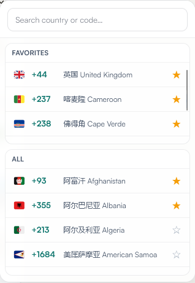
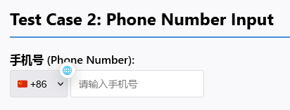

<div align="center">
<h1 align="center">Find-Your-Country-Code</h1>

**English** | [**简体中文**](./README.md)

<p align="center">

**Browser userscript: detects phone country-code fields on any webpage, attaches a 🌐 icon, and opens a searchable dialing-code picker. Works with userscript managers like Tampermonkey.**
</p>
</div>

## Features

- Multi-signal weighted scoring auto-detects country/phone code fields (`select`, `input`, `intl-tel-input` scenarios) with tiered actions by confidence — honorific prefixes, local fixed-line area codes, and pure numeric dropdowns no longer trigger false icons
- High-confidence fields get an automatic 🌐 icon; medium confidence injects low-key (semi-transparent, shrunk, restored on hover); low confidence stays hidden but can be summoned from the panel
- Honors standard `autocomplete` signals (e.g. `tel-country-code`) and validates dropdown options by content
- One click on 🌐 opens the country-code panel; search by Chinese/English country name, ISO code, or dialing code
- Favorites persist via GM storage
- Works on dynamic pages: MutationObserver scanning + SPA route-change rescans, traversing open Shadow DOM
- intl-tel-input v16–v29 adaptation; React/Vue controlled components sync through the native input→change→blur sequence

## Screenshots

<table>
  <tr>
    <td style="vertical-align: top;">
      
    </td>
    <td style="vertical-align: top;">
      
    </td>
  </tr>
</table>

Known boundary: closed shadow roots go undetected; cross-frame panel messaging degrades on nested shadow-hosted frames ([src/main.ts](./src/main.ts)).

## Usage

### Prerequisites

Install one userscript manager:

- [Tampermonkey](https://www.tampermonkey.net/)
- [Greasemonkey](https://www.greasespot.net/)
- [Violentmonkey](https://violentmonkey.github.io/)

### Install the script

**Option 1: direct install**

- [GreasyFork](https://update.greasyfork.org/scripts/573755/Find-Your-Country-Code.user.js)
- [GitHub Release](https://github.com/Xxx91n/Find-Your-Country-Code/releases/latest/download/find-your-country-code.user.js)

**Option 2: manual install**

1. Build from source: clone this repo, run `npm install && npm run build` — the artifact is `dist/find-your-country-code.user.js`.
2. Open your userscript manager's dashboard.
3. Add a new script.
4. Paste the build output and save.

## Versioning & sync

`package.json`'s `version` is the single source of truth: `vite.config.ts` reads it at build time and injects the artifact `// @version`. GitHub Release artifacts ship from [`releases/latest`](https://github.com/Xxx91n/Find-Your-Country-Code/releases/latest).

The [GreasyFork listing](https://greasyfork.org/zh-CN/scripts/573755-find-your-country-code) is a pull-based mirror — GreasyFork fetches updates itself from the `releases/latest` artifact through its "Sync from external URL" setting; this repo never pushes to GreasyFork (GF has no write API). CI runs a daily read-only consistency check ([`gf-alignment-check.yml`](./.github/workflows/gf-alignment-check.yml)) that alerts when the two versions drift. For the latest version first, use the GitHub Release link.

## Contributing

Open an [issue](https://github.com/Xxx91n/Find-Your-Country-Code/issues) or a [PR](https://github.com/Xxx91n/Find-Your-Country-Code/pulls).

Development:

```bash
npm install
npm run dev
npm run build      # artifact: dist/find-your-country-code.user.js
npm run e2e        # build + Playwright e2e tests
```

Bump the version only in `package.json`; the release flow is in [CONTRIBUTING_EN.md](./CONTRIBUTING_EN.md).

## License

[MIT License](./LICENSE)
